# PulseIQ Analytical Star-Schema Warehouse Architecture (Task 2)

## 1. Executive Summary
This document establishes the enterprise star-schema dimensional warehouse for PulseIQ Analytics. 
The schema transforms normalized and quarantined operational data feeds into optimized dimensional models joined via surrogate keys. 

---

## 2. Mermaid Entity-Relationship (ER) Diagram

```mermaid
erDiagram
    %% DIMENSIONS
    DIM_EMPLOYEE {
        bigint employee_key PK "Surrogate Key (SCD Type 2)"
        varchar employee_id "Natural Key"
        varchar full_name
        varchar gender
        date date_of_birth
        date hire_date
        date exit_date
        varchar employment_status
        varchar department_id FK
        varchar role_id FK
        varchar work_location FK
        varchar work_mode
        date valid_from
        date valid_to
        varchar is_current
    }

    DIM_DEPARTMENT {
        varchar department_id PK
        varchar department_name
        varchar cost_center
        varchar is_leadership
    }

    DIM_DATE {
        bigint date_key PK "YYYYMMDD"
        date calendar_date
        bigint year
        bigint month
        varchar month_name
        varchar financial_year
        varchar fiscal_quarter
    }

    DIM_ROLE {
        varchar role_id PK
        varchar role_title
        varchar career_track
        bigint standard_job_level
    }

    DIM_LOCATION {
        varchar location_id PK
        varchar city
        varchar state
        varchar country
        varchar tier
    }

    DIM_LEAVE_TYPE {
        varchar leave_type_code PK
        varchar leave_type_name
        varchar is_paid
    }

    DIM_ACCOUNT {
        bigint account_code PK
        varchar account_name
        varchar account_category
        varchar normal_balance
    }

    DIM_CLIENT {
        varchar client_id PK
        varchar client_name
        varchar industry
        varchar tier
    }

    DIM_VENDOR {
        varchar vendor_id PK
        varchar vendor_name
        varchar category
    }

    DIM_TEAM {
        varchar team_id PK
        varchar team_name
        varchar department_id FK
    }

    DIM_SPRINT {
        varchar sprint_id PK
        varchar sprint_name
        date start_date
        date end_date
    }

    %% FACTS
    FACT_PAYROLL {
        varchar payroll_item_id PK
        varchar run_id
        varchar employee_id
        bigint employee_key FK
        bigint date_key FK
        varchar department_id FK
        varchar role_id FK
        double gross_pay
        double net_pay
        double employer_cost
        double variable_pay
        double overtime_pay
        bigint lop_days
    }

    FACT_ATTENDANCE_MONTHLY {
        varchar attendance_fact_id PK
        varchar employee_id
        bigint employee_key FK
        bigint date_key FK
        varchar department_id FK
        bigint scheduled_days
        bigint present_days
        bigint wfh_days
        bigint unpaid_absence_days
        double attendance_rate
    }

    FACT_LEAVE {
        varchar leave_request_id PK
        varchar employee_id
        bigint employee_key FK
        varchar leave_type_code FK
        bigint start_date_key FK
        bigint end_date_key FK
        bigint days
        varchar status
    }

    FACT_HEADCOUNT_MONTHLY {
        varchar department_id FK
        bigint date_key FK
        bigint headcount_start
        bigint hires
        bigint exits
        bigint voluntary_exits
        bigint headcount_end
        double attrition_rate_monthly_pct
    }

    FACT_LEDGER {
        varchar line_id PK
        varchar entry_id
        bigint date_key FK
        bigint account_code FK
        varchar cost_center_department_id FK
        double debit
        double credit
        double signed_amount_debit_positive
    }

    FACT_INVOICE {
        varchar invoice_id PK
        varchar client_id FK
        bigint service_line_account FK
        bigint invoice_date_key FK
        double total_amount
        double amount_paid
        double balance_due
    }

    FACT_INVOICE_PAYMENT {
        varchar payment_id PK
        varchar invoice_id FK
        bigint payment_date_key FK
        double amount
    }

    FACT_EXPENSE {
        varchar expense_id PK
        varchar vendor_id FK
        bigint category_account FK
        varchar department_id FK
        bigint expense_date_key FK
        double amount_excl_gst
        double gst_amount
        double total_amount
    }

    FACT_TASK {
        varchar task_id PK
        varchar team_id FK
        varchar sprint_id FK
        varchar assignee_employee_id FK
        varchar task_type
        varchar priority
        bigint story_points
        varchar status
        double cycle_time_days
        varchar completed_on_time
    }

    FACT_ANOMALY {
        varchar result_id PK
        varchar employee_id FK
        varchar source_dataset
        double anomaly_score
        varchar flagged
    }

    FACT_ATTRITION_RISK {
        varchar prediction_id PK
        varchar employee_id FK
        varchar department_id FK
        double risk_score_12m
        varchar risk_band
    }

    FACT_FORECAST {
        varchar forecast_id PK
        varchar department_id FK
        varchar metric
        double forecast_value
    }

    %% RELATIONSHIPS
    FACT_PAYROLL }|--|| DIM_EMPLOYEE : "employee_key"
    FACT_PAYROLL }|--|| DIM_DEPARTMENT : "department_id"
    FACT_PAYROLL }|--|| DIM_DATE : "date_key"
    FACT_PAYROLL }|--|| DIM_ROLE : "role_id"

    FACT_ATTENDANCE_MONTHLY }|--|| DIM_EMPLOYEE : "employee_key"
    FACT_ATTENDANCE_MONTHLY }|--|| DIM_DEPARTMENT : "department_id"
    FACT_ATTENDANCE_MONTHLY }|--|| DIM_DATE : "date_key"

    FACT_LEAVE }|--|| DIM_EMPLOYEE : "employee_key"
    FACT_LEAVE }|--|| DIM_LEAVE_TYPE : "leave_type_code"

    FACT_HEADCOUNT_MONTHLY }|--|| DIM_DEPARTMENT : "department_id"
    FACT_HEADCOUNT_MONTHLY }|--|| DIM_DATE : "date_key"

    FACT_LEDGER }|--|| DIM_ACCOUNT : "account_code"
    FACT_LEDGER }|--|| DIM_DEPARTMENT : "cost_center_department_id"
    FACT_LEDGER }|--|| DIM_DATE : "date_key"

    FACT_INVOICE }|--|| DIM_CLIENT : "client_id"
    FACT_INVOICE }|--|| DIM_ACCOUNT : "service_line_account"

    FACT_INVOICE_PAYMENT }|--|| FACT_INVOICE : "invoice_id"

    FACT_EXPENSE }|--|| DIM_VENDOR : "vendor_id"
    FACT_EXPENSE }|--|| DIM_ACCOUNT : "category_account"
    FACT_EXPENSE }|--|| DIM_DEPARTMENT : "department_id"

    FACT_TASK }|--|| DIM_TEAM : "team_id"
    FACT_TASK }|--|| DIM_SPRINT : "sprint_id"

    FACT_ATTRITION_RISK }|--|| DIM_DEPARTMENT : "department_id"
    FACT_FORECAST }|--|| DIM_DEPARTMENT : "department_id"
```

---

## 3. Explaining `employee_key` to a Friend
> **The Problem:** 
> Imagine Sarah worked in **Sales** from January to June, generating deals and drawing a Sales salary. On July 1st, she transfers to **Customer Support**. 
> If you only have Sarah's permanent badge number (`employee_id = 'EMP-0123'`) and you look up her department today, the database will say "Support". 
> If you calculate your Q1/Q2 departmental costs using badge number, Sarah's January–June salary will suddenly be charged to Customer Support! Sales will look artificially profitable, Support will look over-budget, and historical analytics will be distorted.
>
> **The Solution (Surrogate Key `employee_key`):**
> Instead of using just badge numbers, the warehouse creates a new **surrogate key** (`employee_key`) each time Sarah's attributes change (Slowly Changing Dimension Type 2).
> - Version 1: `employee_key = 10005`, Sarah, Sales, Valid: 2026-01-01 to 2026-06-30.
> - Version 2: `employee_key = 10088`, Sarah, Support, Valid: 2026-07-01 to 9999-12-31.
>
> The fact table records Sarah's June pay against `employee_key = 10005` (Sales), and her July pay against `employee_key = 10088` (Support). A single simple join (`JOIN dim_employee USING (employee_key)`) automatically assigns her cost to the exact department where she was actually working in that month!

---

## 4. Think for Yourself: Transfer Cost Attribution Rule

> **Scenario:** A person moved from Sales to Support in July. In whose cost does their June pay belong? Write the rule.

### Official Accounting & Warehousing Rule:
1. **Economic Value Matching Principle:** Payroll cost must be matched to the revenue and department where the employee performed service and created economic benefit during that payroll cycle.
2. **Attribution Rule:** 
   The employee's June pay belongs **100% to Sales**. Support cost attribution only begins for payroll periods effective on or after July 1st.
3. **Warehouse Join Implementation:**
   Fact tables must join to `dim_employee` via the point-in-time surrogate key (`employee_key`), satisfying:
   $$\text{fact\_payroll.period\_end\_date} \in [\text{dim\_employee.valid\_from}, \text{dim\_employee.valid\_to}]$$
   Under this join, June pay links to the historical dimension record where `department_id = 'D04'` (Sales).

---

## 5. Row Count Reconciliation to Task 1

| Fact Table | Task 1 Passed Rows | Warehouse Rows | Status |
| :--- | :---: | :---: | :---: |
| `fact_payroll` | 7,342 | 7,342 | **100% Reconciled** |
| `fact_attendance_monthly` | 7,343 | 7,343 | **100% Reconciled** |
| `fact_leave` | 3,439 | 3,439 | **100% Reconciled** |
| `fact_headcount_monthly` | 891 | 891 | **100% Reconciled** |
| `fact_ledger` | 6,784 | 6,784 | **100% Reconciled** |
| `fact_invoice` | 742 | 742 | **100% Reconciled** |
| `fact_invoice_payment` | 709 | 709 | **100% Reconciled** |
| `fact_expense` | 500 | 500 | **100% Reconciled** |
| `fact_task` | 28,848 | 28,848 | **100% Reconciled** |
| `fact_anomaly` | 405 | 405 | **100% Reconciled** |
| `fact_attrition_risk` | 430 | 430 | **100% Reconciled** |
| `fact_forecast` | 72 | 72 | **100% Reconciled** |

Every fact table matches the passed rows from Task 1 with zero row loss.

---

## 6. Orphan Check & Referential Integrity Audit

| Fact Relationship | Foreign Key | Dimension Key | Orphan Count | Resolution & Root Cause |
| :--- | :--- | :--- | :---: | :--- |
| `fact_payroll` -> `dim_employee` | `employee_key` | `employee_key` | 0 | Planted foreign keys `PI-X0003` & `PI-X0004` (employee_key = -1) resolve to default unknown member row `(-1, 'EMP-UNKNOWN')`. |
| `fact_payroll` -> `dim_department` | `department_id` | `department_id` | 0 | All valid departments conformed. |
| `fact_attendance` -> `dim_employee`| `employee_key` | `employee_key` | 0 | Point-in-time keys conformed. |
| `fact_leave` -> `dim_employee` | `employee_key` | `employee_key` | 0 | Conformed. |
| `fact_headcount` -> `dim_department`| `department_id` | `department_id` | 0 | Conformed. |
| `fact_ledger` -> `dim_account` | `account_code` | `account_code` | 0 | Chart of accounts conformed. |
| `fact_invoice` -> `dim_client` | `client_id` | `client_id` | 0 | Client dimension conformed. |
| `fact_invoice_payment` -> `fact_invoice` | `invoice_id` | `invoice_id` | 1 | **Explained:** 1 payment references invoice `INV-00385`, which was quarantined in Task 1 due to negative balance/overpayment defect (DQ-05). |
| `fact_forecast` -> `dim_department` | `department_id` | `department_id` | 0 | Resolved: Added company-wide consolidated department `'ALL'` to `dim_department`. |

**Conclusion:** 0 unexplained orphans. All warehouse models conform to enterprise referential integrity.
