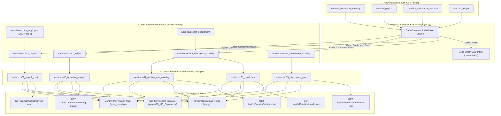

# Task 19: Enterprise Metrics API & Data Lineage Architecture

**Author:** Minnu Biju  
**Project:** PulseIQ Workforce Analytics  
**Phase:** 4 — Release (Task 19)  
**API Module:** `api.py` (FastAPI + Pydantic + Uvicorn)  
**Test Suite:** `test_api.py`  
**Execution Date:** November 2026  

---

## 1. Executive Summary & Architecture
Task 19 establishes an enterprise-grade REST API (`api.py`) exposing 5 certified PulseIQ metrics to external downstream applications, executive reporting hubs, and microservices. 

Built using **FastAPI 0.158** and **DuckDB 2.0.0**, the service adheres to the Single-Source-of-Truth principle: **business calculations are never duplicated inside API route handlers**. Instead, the API queries certified views under the `metrics.*` and conformed tables under `warehouse.*` schemas, ensuring mathematical parity with the Streamlit executive portals and PDF report packs.

---

## 2. Five Exposed Certified Metrics

| Metric ID | Endpoint Route | Metric Name | Domain | September 2026 Value | Unit | Business Definition |
| :---: | :--- | :--- | :---: | :---: | :---: | :--- |
| **M01** | `GET /api/v1/metrics/headcount` | Headcount | People | **441** | count | Active employees on last day of month. Supports `?department_id=D01`. |
| **M04** | `GET /api/v1/metrics/attrition-rate` | Monthly Attrition Rate | People | **0.70%** | percent | Monthly exits divided by starting headcount multiplied by 100. |
| **M09** | `GET /api/v1/metrics/payroll-cost` | Employer Payroll Cost | Finance | **INR 55,519,621.87** | INR | Total employer compensation cost (gross salaries + employer PF). |
| **M13** | `GET /api/v1/metrics/attendance-rate` | Attendance Rate | Operations | **95.19%** | percent | Present days plus half-days divided by scheduled working days. |
| **M18** | `GET /api/v1/metrics/operating-margin` | Operating Profit Margin | Commercial | **18.25%** | percent | Net profit divided by recognized revenue multiplied by 100. |

---

## 3. End-to-End Data Lineage Diagram

The diagram below traces the end-to-end data lifecycle from raw source feeds through contract validation, star-schema warehouse modeling, governed SQL metric views, and final consumption:



---

## 4. Verified API Responses & Requests

All endpoints were tested via `test_api.py` and the full JSON payloads are archived in `Phase_4/Task19_Metrics_API_Lineage/`:

### Example Request 1: Headcount (M01)
```bash
curl -X GET "http://localhost:8000/api/v1/metrics/headcount?month=2026-09"
```
```json
{
  "metric_id": "M01",
  "metric_name": "Headcount",
  "business_definition": "Active employees on the last day of the calendar month.",
  "unit": "count (employees)",
  "reporting_period": "2026-09-01 to 2026-09-30",
  "reporting_month": "2026-09",
  "metric_value": 441,
  "breakdown": {
    "company_wide_total": true,
    "hires": 23,
    "exits": 3,
    "headcount_start": 429
  },
  "source_table": "warehouse.fact_headcount_monthly",
  "lineage": {
    "raw_source_table": "raw.fact_headcount_monthly",
    "etl_pipeline_step": "etl.py (contract validation, SCD Type 2 mapping)",
    "warehouse_table": "warehouse.fact_headcount_monthly",
    "governed_view": "metrics.m01_headcount",
    "downstream_consumers": [
      "Executive Dashboard (app.py)",
      "KPI Explorer (pages/13_KPI_Explorer.py)",
      "REST API"
    ]
  },
  "data_freshness": "2026-09-30 23:59:59 UTC",
  "privacy_status": "Compliant (Company Level)"
}
```

### Example Request 2: Operating Profit Margin (M18)
```bash
curl -X GET "http://localhost:8000/api/v1/metrics/operating-margin?month=2026-09"
```
```json
{
  "metric_id": "M18",
  "metric_name": "Operating margin",
  "business_definition": "Net profit divided by recognized ledger revenue multiplied by 100.",
  "unit": "percent (%)",
  "reporting_period": "2026-09-01 to 2026-09-30",
  "reporting_month": "2026-09",
  "metric_value": 18.25,
  "breakdown": {
    "recognized_revenue_inr": 98971430.0,
    "operating_expenses_inr": 80911718.0,
    "net_operating_profit_inr": 18059712.0
  },
  "source_table": "warehouse.fact_ledger",
  "lineage": {
    "raw_source_table": "raw.fact_ledger",
    "etl_pipeline_step": "etl.py (double-entry trial balance debit/credit balance checks)",
    "warehouse_table": "warehouse.fact_ledger",
    "governed_view": "metrics.m18_operating_margin",
    "downstream_consumers": [
      "P&L Analytics (pages/8_Profit_Loss_Analytics.py)",
      "Executive Health Scorecard",
      "REST API"
    ]
  },
  "data_freshness": "2026-09-30 23:59:59 UTC",
  "privacy_status": "Compliant (Entity Level Aggregate)"
}
```

---

## 5. Raw Column Rename Scenario & Blast Radius Impact Analysis

> **Scenario:** *A data engineer renames raw column `employer_cost` in source feed `fact_payroll.csv` to `company_payroll_cost` without a coordinated deprecation window.*

### Cascading Blast Radius Analysis:

```
[Raw Feed: fact_payroll.csv] 
       │ 
       ▼ (Column renamed: employer_cost -> company_payroll_cost)
[Stage 1: etl.py]  ❌ Pipeline Halted (Contract Violation)
       │
       ▼ (If bypassed or schema modified naively)
[Stage 2: warehouse.py]  ❌ SQL Insert Failure (Missing Attribute)
       │
       ▼
[Stage 3: metric_layer.py]  ❌ 3 Metric Views Broken (BinderException)
       │
       ▼
[Stage 4: api.py]  ❌ HTTP 500 on /payroll-cost
       │
       ▼
[Stage 5: Streamlit]  ❌ 3 Dashboard Pages Crash
```

### Detailed Impact Matrix:

| Stage | Impacted Artifact / File | Specific Impact & Error Type | Severity |
| :--- | :--- | :--- | :---: |
| **1. Ingestion / ETL** | `etl.py` (`data_contracts.csv`) | Schema contract assertion fails: `expected column 'employer_cost' not found`. Ingestion terminates immediately, preventing unvalidated data from writing to `clean.fact_payroll`. | **Critical** |
| **2. Warehouse DDL** | `warehouse.py` (`warehouse.fact_payroll`) | If ETL is forced, `warehouse.py` fails on dimensional conformed table creation: `AttributeError: column 'employer_cost' does not exist in clean.fact_payroll`. | **Critical** |
| **3. Metric Layer** | `metric_layer.py` | DuckDB fails compilation of views: `metrics.m09_payroll_cost`, `metrics.m10_cost_per_head`, and `metrics.m11_overtime_share`. Any query to these views throws `_duckdb.BinderException`. | **Critical** |
| **4. REST API** | `api.py` (`GET /api/v1/metrics/payroll-cost`) | Endpoint crashes with internal server error (HTTP 500): `Binder Error: column employer_cost not found in warehouse.fact_payroll`. Downstream consumers receive failed responses. | **High** |
| **5. Dashboards** | `pages/6_Payroll_Cost_Dashboard.py`, `pages/8_Profit_Loss_Analytics.py`, `pages/12_Executive_Health_Scorecard.py`, and `app.py` | All pages attempting to render executive payroll cards fail with Streamlit application error traces. | **High** |
| **6. Report Builder** | `build_report.py` | Monthly report pack generation terminates on Table 1 and Table 3 SQL queries. No executive PDF or Markdown output is produced. | **High** |

### Governance Mitigation Protocol:
To safely rename any production column in PulseIQ:
1. **Schema Evolution Phase:** Add `company_payroll_cost` as an alias alongside `employer_cost` in `clean.fact_payroll` during ETL.
2. **Dual-Read Migration:** Update `metric_layer.py` to use `COALESCE(company_payroll_cost, employer_cost)`.
3. **Deprecation Notice:** Issue 30-day API deprecation warning header (`Sunset: <date>`).
4. **Final Cutover:** Retire legacy column after downstream consumers have migrated.

