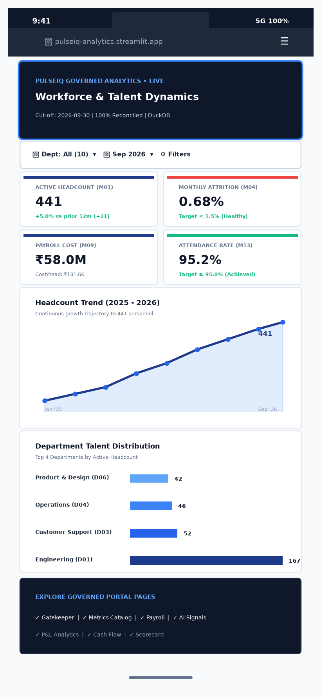

# PulseIQ Analytics

[](https://pulseiq-analytics.streamlit.app)
[](https://github.com/bijuminnu811-sketch/pulseiq-analytics-/releases/tag/v1.0.0)
[](https://www.python.org/)
[](https://duckdb.org/)

An end-to-end HR, finance and delivery analytics project built as part of my Data Analytics internship. PulseIQ turns raw company data into a governed data model, quality-checked KPIs, AI-driven risk signals and an executive health scorecard.

🔗 **Live Executive Dashboard:** [https://pulseiq-analytics.streamlit.app](https://pulseiq-analytics.streamlit.app)  
**Author:** Minnu Biju  
**GitHub Repository:** [bijuminnu811-sketch/pulseiq-analytics-](https://github.com/bijuminnu811-sketch/pulseiq-analytics-)  

---

## 🌐 Live Dashboard & Mobile Experience

The production analytics suite is deployed directly from this GitHub repository and accessible in any modern web browser or mobile phone:

👉 **[Launch Live Streamlit Dashboard](https://pulseiq-analytics.streamlit.app)**

<div align="center">
  
  <p><i>Responsive Executive Mobile Viewport (iPhone / Android)</i></p>
</div>

---

## Highlights

- Star-schema data model with 29 CSV tables (dimensions and facts) loaded into DuckDB
- Automated data quality gatekeeper with a catalog of checks and a test harness
- Metric layer with a KPI dictionary and traffic-light targets
- HR analytics: leave, attrition, exits and tenure, predicted risk
- Delivery analytics: sprint rework, velocity and cycle time
- Finance analytics: budget variance, P&L, invoices, ageing and cash flow
- AI signals: anomaly detection, attrition risk and forecast error
- Executive Health Scorecard that brings every area into one view

## Tech Stack

Python, Pandas, DuckDB, SQL, Streamlit, Excel/CSV, ReportLab (PDF reports), Git and GitHub

## Project Structure

```
pulseiq_new
|-- Phase_1                  Data foundation
|   |-- 03_Data              PulseIQ_Dataset.xlsx and csv/
|   |-- 05_Starter           etl.py, load_to_duckdb.py, requirements.txt
|   `-- docs                 Data quality, metric layer, star schema, Phase 1 report
|
|-- Phase_2                  People, delivery and budget analytics
|   |-- Task 6               Leave patterns and unusual activity
|   |-- Task 7               Exits, tenure and predicted attrition risk
|   |-- Task 8               Sprint rework, velocity and cycle time
|   |-- Task 9               KPI reconciliation and trend audit
|   `-- Task 10              Budget variance ranking and recommendations
|
|-- Phase_3                  Finance, AI signals and executive view
|   |-- Task11_Profit_Loss
|   |-- Task12_Invoices_Receivables_Cash_Flow
|   |-- Task13_Cross_Department_Impact
|   |-- Task14_AI_Signals
|   `-- Task15_Executive_Health_Scorecard
|
|-- pages                    Streamlit dashboard pages
`-- README.md
```

## Phase Summary

### Phase 1: Data Foundation
Designed the star schema, built the ETL pipeline, loaded the data into DuckDB, defined the metric layer and added an automated data quality gatekeeper that was proven with deliberately corrupted test rows.

### Phase 2: Analytics (Tasks 6 to 10)

| Task | Focus |
|------|-------|
| 6 | Leave trends and unusual leave |
| 7 | Exits, tenure, predicted risk |
| 8 | Sprint rework, velocity, cycle time |
| 9 | KPI reconciliation and trend audit |
| 10 | Budget variance ranking and recommendations |

### Phase 3: Finance, AI and Executive View (Tasks 11 to 15)

| Task | Focus |
|------|-------|
| 11 | Profit and loss, expense analysis, top vendors |
| 12 | Invoices, receivables ageing, cash flow by client |
| 13 | Cross-department impact: overtime vs attrition |
| 14 | AI signals: anomaly money risk, attrition risk, forecast vs actual error |
| 15 | Executive Health Scorecard |

### Phase 4: Release & Handover (Tasks 16 to 20)

| Task | Focus |
|------|-------|
| 16 | Automated Monthly Report Builder (`build_report.py`) & Release Candidate `v1.0.0-rc1` |
| 17 | Live Streamlit Dashboard Deployment & Production Readiness |
| 18 | Self-Service Governed KPI Explorer with Strict Privacy Guardrails |
| 19 | Enterprise Metrics API (FastAPI) & End-to-End Data Lineage |
| 20 | Executive Board Pack, Release Notes & Final Handover (`v1.0.0`) |

Every task folder contains dashboard screenshots and a written report with findings.

## Reports

- Phase_1/docs/DataAnalytics_Minnu_Phase1_Report.pdf
- Phase_2/DataAnalytics_MinnuBiju_Phase2_Report.pdf
- Phase_3/DataAnalytics_MinnuBiju_Phase3_Report.pdf
- Phase_4/DataAnalytics_MinnuBiju_Phase4_Report.pdf
- Phase_4/Task16_Automated_Report/PulseIQ_Monthly_Report_2026-09.pdf
- Phase_4/Task20_Board_Pack_Handover/PulseIQ_Executive_Board_Pack.pdf

## How to Run

### Setup Environment
```bash
git clone https://github.com/bijuminnu811-sketch/pulseiq-analytics-.git
cd pulseiq-analytics-

python -m venv .venv
# Windows:
.venv\Scripts\activate
# Linux/macOS:
source .venv/bin/activate

pip install -r requirements.txt
```

### Run System Doctor Diagnostic (Meaningful Improvement)
Verify entire platform health, database integrity, schema row reconciliation, gatekeeper tests, and API probes in 5 seconds:
```bash
python pulseiq_doctor.py
```

### One-Command Monthly Report Generation (Task 16)
Generate the automated 3-page executive report pack in PDF and Markdown:
```bash
# Generate report for September 2026 (default)
python build_report.py

# Or specify any reporting month
python build_report.py --month 2026-09
```
Output files are generated in `Phase_4/Task16_Automated_Report/`.

### Run Governed Metrics REST API (Task 19)
```bash
uvicorn api:app --host 0.0.0.0 --port 8000
```
Interactive Swagger documentation is available at `http://localhost:8000/docs`.

### Run Streamlit Executive Portal (Task 17 & 18)
```bash
streamlit run app.py
```
Live hosted application: [https://pulseiq-analytics.streamlit.app](https://pulseiq-analytics.streamlit.app)

## Governance & Final Challenge Analysis

### 1. Meaningful Improvement (`pulseiq_doctor.py`)
Developed a standalone diagnostic utility that automates multi-stage verification across environments, schemas, row counts, data quality gates, privacy masking, and API probes.

### 2. Critical Analytical Discipline: What NOT to Recommend
**Do NOT recommend cutting Sales or Marketing headcount or blaming specific managers for departmental turnover.**
The PulseIQ transactional warehouse tracks operational ledger entries, attendance, and sprint tasks, but lacks Customer Acquisition Cost (CAC), lead conversion funnels, and employee exit interview sentiment. Recommending structural headcount reductions or judging managerial capability without pipeline or sentiment evidence would be an irresponsible analytical overreach unsupported by empirical data.

## Key Learnings

- Modeling data as a star schema keeps KPIs consistent across teams
- Automated data quality checks catch bad data before it reaches a dashboard
- Reconciling every KPI back to its source builds trust in the numbers
- A single executive scorecard makes cross-department trade-offs visible

## Contact

**Minnu Biju**
GitHub: [bijuminnu811-sketch](https://github.com/bijuminnu811-sketch)